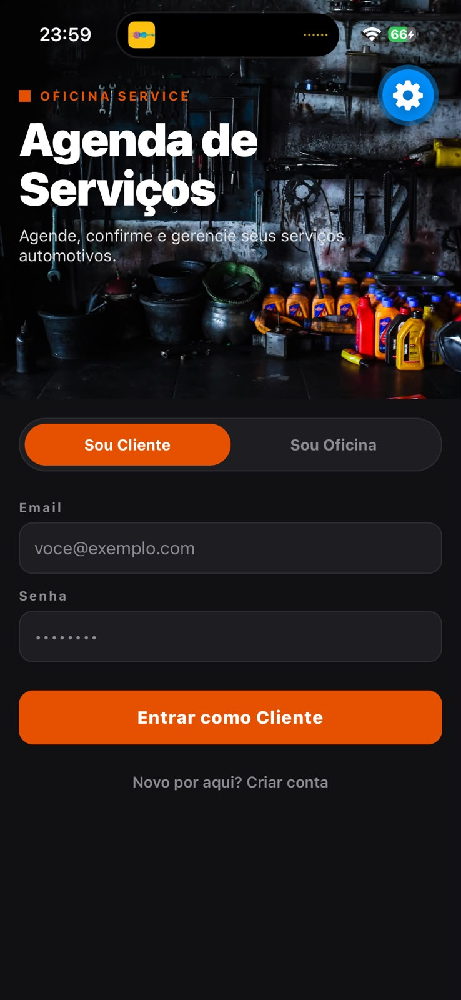
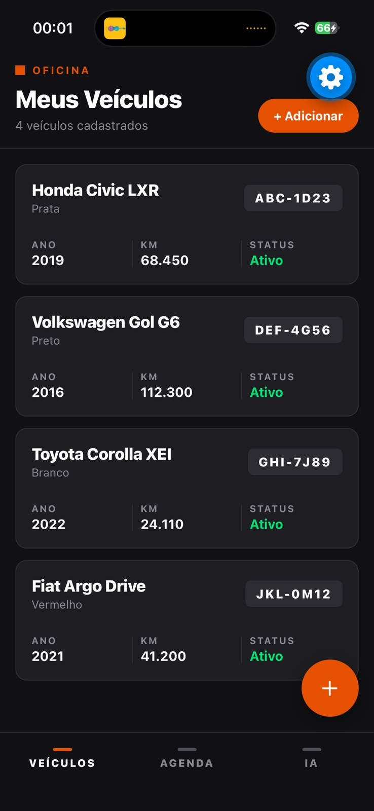
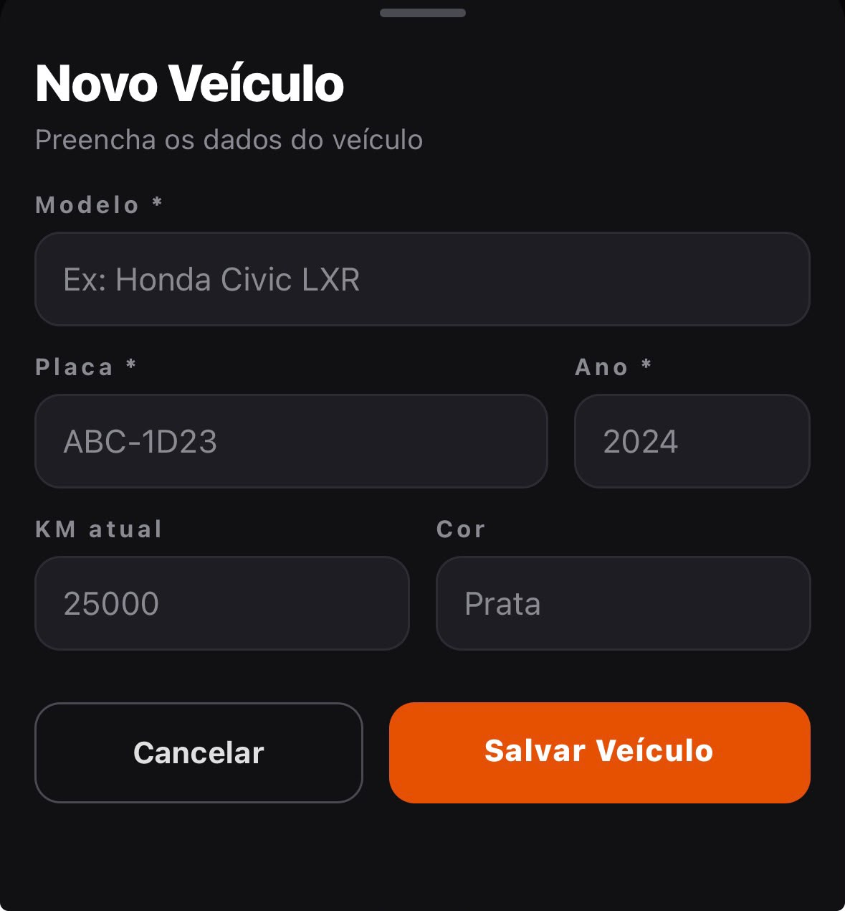
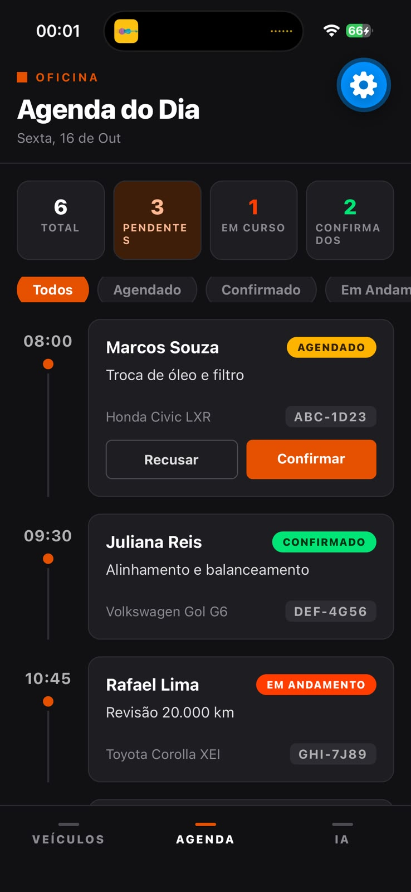
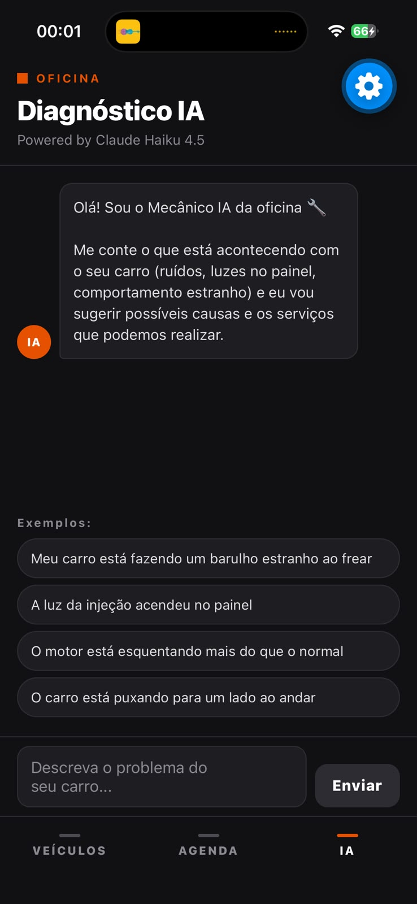

# 🔧 Agenda de Serviços da Oficina

Aplicativo mobile desenvolvido em **React Native + Expo** para a disciplina de **Programação para Dispositivos Móveis em Android**.

**Dupla:** Nicolas Gabriel & Luiz Eduardo
**Entregas:** Checkpoint 2 – Interface funcional (16/10) · Checkpoint 3 – Persistência (23/10)

---

## 📱 Sobre o projeto

O app conecta **clientes** e **oficinas mecânicas**:

- O **cliente** cadastra e acompanha seus veículos e pode pedir uma pré-análise de problemas com um assistente de IA.
- A **oficina** visualiza a agenda do dia e confirma ou recusa agendamentos.

O tema visual é *dark-first* com destaque laranja industrial.

## ✅ Funcionalidades (Checkpoint 2)

| Tela | Responsável | O que faz |
|------|-------------|-----------|
| **Login / Cadastro** | Dupla | Toggle *Sou Cliente / Sou Oficina*, alternância Entrar/Cadastrar, validação de e-mail e senha obrigatórios |
| **Meus Veículos** | Nicolas Gabriel | Lista de veículos (FlatList), cadastro via modal com validação de campos obrigatórios (modelo, placa e ano) |
| **Agenda do Dia** | Luiz Eduardo | Resumo do dia, filtros por status, timeline de cards, botões Confirmar/Recusar que atualizam o status e os contadores |
| **Diagnóstico IA** | Dupla | Chat com Claude Haiku 4.5 que sugere causas prováveis, serviços e urgência |

### Validações básicas implementadas
- **Login:** exibe erro se e-mail ou senha estiverem vazios.
- **Novo veículo:** exige modelo, placa e ano; placa é convertida para maiúsculas; ano e KM aceitam apenas teclado numérico.
- **Diagnóstico IA:** não envia mensagem vazia; limite de 500 caracteres; tratamento de erro de conexão.

## 💾 Persistência (Checkpoint 3)

Os dados de **veículos** e da **agenda** agora ficam salvos em um banco **SQLite** local (`expo-sqlite`, arquivo `oficina.db`), então continuam no aparelho mesmo depois de fechar o app.

| Tabela | Campos | Usada em |
|--------|--------|----------|
| `veiculos` | id, modelo, placa (UNIQUE), ano, km, cor | Meus Veículos |
| `agendamentos` | id, horario, cliente, veiculo, placa, servico, status | Agenda do Dia |

- **Cadastro:** o modal de novo veículo faz `INSERT` no SQLite; placa repetida é recusada (`UNIQUE`).
- **Consulta:** ao abrir as telas, a lista vem de `SELECT` no banco.
- **Atualização:** Confirmar/Recusar na agenda fazem `UPDATE` do status, que permanece após reabrir o app.
- **Primeiro uso:** as tabelas são criadas e populadas com os dados de exemplo (`src/mocks/data.js`).
- Código em `frontend/src/database/db.js`.

## 🖼️ Capturas de tela

| Login | Meus Veículos | Novo Veículo |
|:---:|:---:|:---:|
|  |  |  |

| Agenda do Dia | Diagnóstico IA |
|:---:|:---:|
|  |  |

## 🧰 Tecnologias

- Expo SDK 57 / React Native 0.86
- React Navigation v7 (Native Stack + Bottom Tabs)
- TanStack React Query
- expo-image, expo-linear-gradient, react-native-safe-area-context
- Backend: FastAPI + MongoDB (rota de diagnóstico com IA)
- Persistência local com **SQLite** (`expo-sqlite`); `frontend/src/mocks/data.js` só fornece os dados iniciais

## 🗂️ Estrutura

```
frontend/
├── index.js                  # registerRootComponent(App)
├── App.js                    # providers + navegação
└── src/
    ├── navigation/AppNavigator.js   # Stack (Login -> Tabs) + Bottom Tabs
    ├── screens/
    │   ├── LoginScreen.js
    │   ├── VeiculosScreen.js         # Nicolas
    │   ├── AgendaOficinaScreen.js    # Luiz
    │   └── DiagnosticoScreen.js
    ├── components/
    │   ├── Header.js
    │   └── CardAgendamento.js        # Luiz
    ├── database/db.js               # SQLite: tabelas e consultas
    ├── mocks/data.js
    └── theme.ts
backend/
└── server.py                 # API FastAPI (/api/diagnostico)
```

## ▶️ Como executar

```bash
cd frontend
yarn install
npx expo install expo-sqlite   # necessário para a persistência (Checkpoint 3)
npx expo start
```

Abra no **Expo Go** (Android) escaneando o QR Code, ou pressione `a` para o emulador Android.

Para a aba **Diagnóstico IA**, defina `EXPO_PUBLIC_BACKEND_URL` apontando para o backend e rode-o:

```bash
cd backend
pip install -r requirements.txt
uvicorn server:app --reload --port 8001
```

O backend requer as variáveis `MONGO_URL`, `DB_NAME` e `EMERGENT_LLM_KEY` no arquivo `backend/.env`.

## 👥 Divisão de responsabilidades

- **Nicolas Gabriel:** gerenciamento de veículos (lista, cadastro via modal, estado local).
- **Luiz Eduardo:** manipulação de status da agenda (confirmar, recusar, filtros, timeline).
- **Em conjunto:** login, navegação, tema, componente de cabeçalho e diagnóstico com IA.

## 🔜 Próximos passos

- Autenticação real e sincronização dos dados do SQLite com o backend.
- Cliente poder solicitar agendamento direto pelo app.
