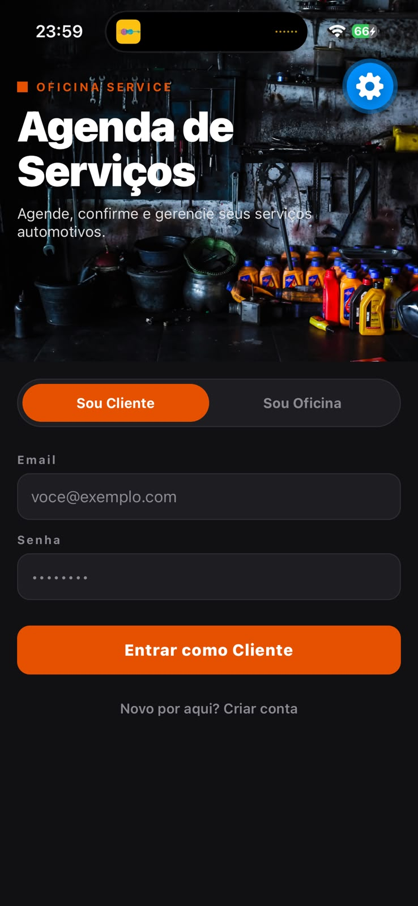
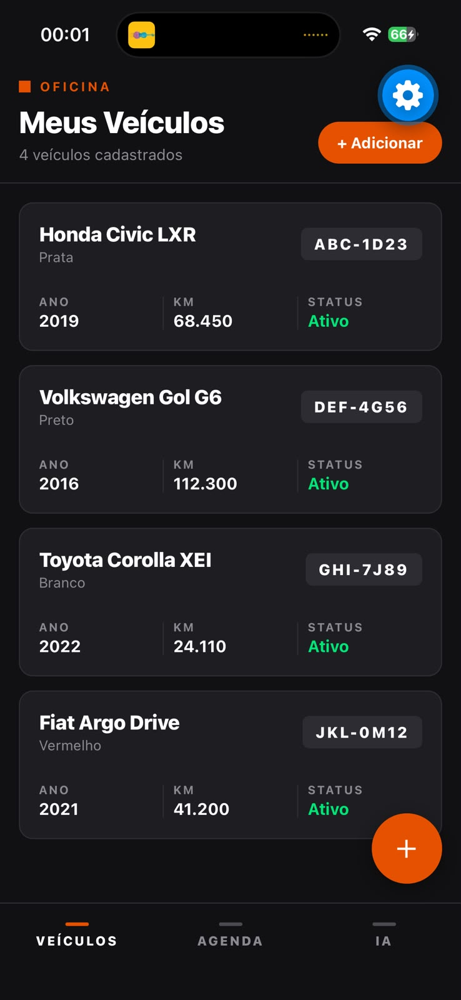
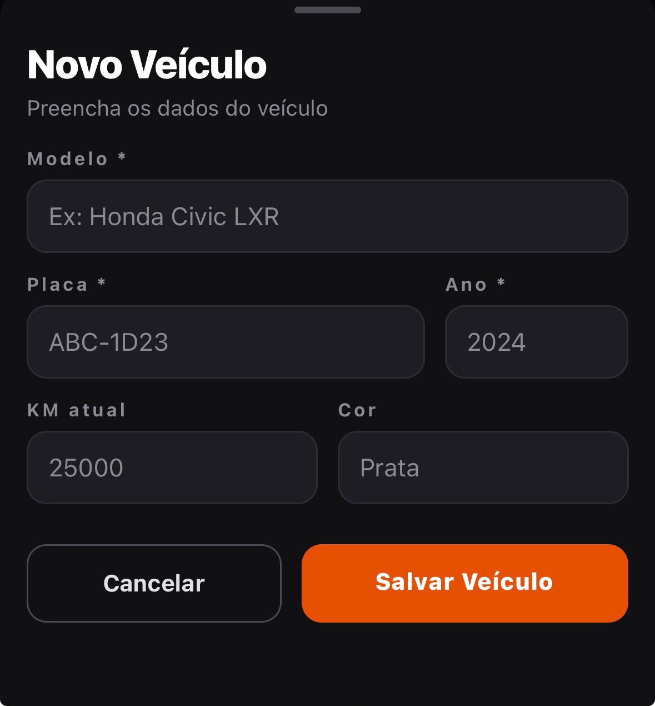
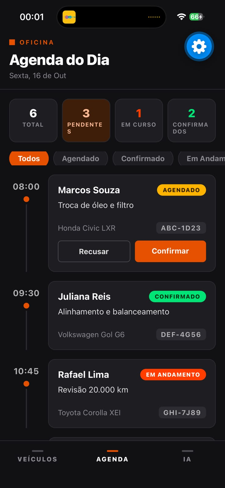
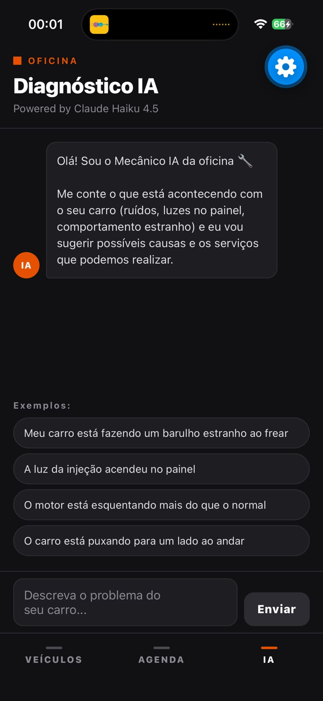

# 🔧 Agenda de Serviços da Oficina

Aplicativo mobile desenvolvido em **React Native + Expo** para a disciplina de **Programação para Dispositivos Móveis em Android**.

**Dupla:** Nicolas Gabriel & Luiz Eduardo
**Entregas:** Checkpoint 2 – Interface funcional (16/10) · Checkpoint 3 – Persistência (23/10) · Avaliação 2 – CRUD (30/10) · **Pré-entrega – Release Candidate (13/11)**

---

## 📱 Sobre o projeto

O app conecta **clientes** e **oficinas mecânicas**:

- Cada **oficina** tem o seu cadastro, a sua agenda e os **seus clientes, com exclusividade**: o cliente pertence a uma única oficina e só agenda nela (ex.: o cliente *Nicolas* é da *Oficina GS* e só agenda na GS).
- O **cliente** cria sua conta informando o **nome fantasia** da sua oficina (só com um nome válido ele ganha acesso à agenda), cadastra seus veículos, consulta os dias e horários disponíveis **da sua oficina**, **solicita um horário** e acompanha o status do pedido. Também pode pedir uma pré-análise de problemas com um assistente de IA.
- A **oficina** (dono) vê só a agenda dos seus clientes e é a única que **confirma ou cancela** esses agendamentos.

O tema visual é *dark-first* com destaque laranja industrial.

## 🚦 Release Candidate (pré-entrega 13/11)

**Estado:** versão quase final. O fluxo principal está implementado e coberto por testes automatizados das regras do banco (tabela de testes abaixo); a interface foi revisada. O que ainda falta está na [lista de pendências](#-lista-de-pendências).

**Fluxo principal:** a oficina se cadastra → o cliente cria conta escolhendo a oficina → cadastra o veículo → solicita um horário → o dono confirma ou recusa → o cliente vê o resultado.

## ✅ Funcionalidades (Checkpoint 2)

| Tela | Perfil | Responsável | O que faz |
|------|--------|-------------|-----------|
| **Login / Cadastro** | Todos | Dupla | Entrar (Cliente ou Oficina) com senha verificada no banco. **Cliente** cria conta informando o **nome fantasia** da sua oficina (precisa existir); **Oficina** cadastra o próprio nome fantasia e a conta do dono |
| **Meus Veículos** | Cliente | Nicolas Gabriel | Lista **somente os veículos do cliente logado**; cadastro via modal com validação (modelo, placa e ano) |
| **Horários** | Cliente | Dupla | Escolhe o dia, vê quais horários da **sua oficina** estão disponíveis ou ocupados (sem dados de outros clientes) e toca em **Solicitar horário** (veículo + serviço). Acompanha o status em *Minhas solicitações* |
| **Agenda** | Oficina | Luiz Eduardo | Agenda por dia **só dos clientes da própria oficina**, filtros por status, **Confirmar / Recusar / Cancelar** (só o dono daquela oficina) |
| **Diagnóstico IA** | Todos | Dupla | Chat com Claude Haiku 4.5 que sugere causas prováveis, serviços e urgência |

### Validações básicas implementadas
- **Login:** exibe erro se e-mail ou senha estiverem vazios, se a senha estiver errada ou se o perfil escolhido não for o da conta.
- **Dias de atendimento:** a oficina funciona de **segunda a sexta**; sábado e domingo são fechados (não aparecem na lista de dias e o banco recusa pedidos nesses dias).
- **Solicitar horário:** exige um horário livre, um dos seus veículos e a descrição do serviço (3 a 120 caracteres); não aceita horário passado nem já ocupado.
- **Cadastro de cliente:** nome obrigatório, **oficina existente, escolhida nas sugestões ao digitar o nome fantasia** (aceita variações de maiúsculas, acentos e espaços; nome inexistente é recusado e a conta não é criada), e-mail válido e único, senha com no mínimo 6 caracteres e confirmação igual.
- **Cadastro de oficina:** nome fantasia único (sem diferenciar maiúsculas, acentos e espaços extras; mínimo 3 letras), nome do responsável, e-mail único e senha com no mínimo 6 caracteres.
- **Novo veículo:** exige modelo, placa e ano; placa é convertida para maiúsculas; ano e KM aceitam apenas teclado numérico.
- **Diagnóstico IA:** não envia mensagem vazia; limite de 500 caracteres; tratamento de erro de conexão.

## 💾 Persistência (Checkpoint 3)

Os dados ficam em um banco **SQLite** local (`expo-sqlite`, arquivo `oficina.db`) e continuam no aparelho depois de fechar o app. Código em `frontend/src/database/db.js`.

| Tabela | Campos principais | Usada em |
|--------|-------------------|----------|
| `oficinas` | id, nome (nome fantasia, UNIQUE), nome_busca (chave normalizada, UNIQUE) | Cadastro de oficinas e vínculo do cliente pelo nome fantasia |
| `usuarios` | id, nome, e-mail (UNIQUE), senha_hash + salt, perfil (Cliente/Oficina), **oficina_id** | Login e cadastro. Todo usuário pertence a **uma** oficina |
| `sessao` | usuario_id | Mantém o usuário logado ao reabrir o app |
| `veiculos` | id, **usuario_id**, modelo, placa (UNIQUE), ano, km, cor | Meus Veículos |
| `agendamentos` | id, **data**, horário, cliente, veículo, placa, serviço, status, **usuario_id** (quem solicitou), **oficina_id** | Agenda e Horários |

- **Senhas** nunca são guardadas em texto: usa-se SHA-256 com salt aleatório (`seguranca.js`).
- **Cada cliente enxerga só os seus veículos** (`WHERE usuario_id = ?`).
- **Exclusividade por oficina:** o cliente fica ligado à oficina cujo **nome fantasia** informou no cadastro e **só agenda nela**. No cadastro, ao digitar as primeiras letras o app **sugere oficinas** cujo nome começa com o texto (ex.: `eron` → *Eron Auto*) e o cliente toca na desejada. Para não expor a lista completa, as sugestões só aparecem com **2+ letras**, casam só pelo **início** do nome e mostram **no máximo 5**; a validação final continua exigindo uma oficina existente. A busca ignora maiúsculas, acentos e espaços extras (`mecanica  premium` encontra *Mecânica Premium*). A oficina do pedido vem da conta dele, não de dados enviados pelo app. Cada oficina tem a sua agenda: o mesmo dia e horário pode estar livre em uma oficina e ocupado em outra.
- **Permissões aplicadas no banco**, não só na interface:
  - só a **Oficina** lista os agendamentos e altera o status (confirmar/cancelar), e **apenas os da própria oficina**: uma oficina não vê nem altera a agenda de outra;
  - o **Cliente** consulta apenas os horários ocupados de um dia **da sua oficina** (`SELECT horario ...`), sem nome, veículo ou serviço de ninguém, e só vê as **suas próprias** solicitações;
  - só o **Cliente** cadastra veículos.
- **Fluxo de agendamento:** o cliente solicita → entra como *Agendado* (aguardando confirmação) → o dono **confirma ou recusa** na aba Agenda → o cliente vê o resultado em *Minhas solicitações*.
- Um índice único no banco impede **reserva dupla** do mesmo horário **dentro da mesma oficina**; cancelar um agendamento libera o horário.
- Bancos de versões anteriores são atualizados automaticamente (`ALTER TABLE`), sem perder dados: contas, veículos e agenda já existentes passam a pertencer à **Oficina GS**.
- No primeiro uso, o banco é criado com **duas oficinas de exemplo** (cada uma com seu dono, seu cliente, veículos e agenda), em `src/mocks/data.js`.

### Contas de demonstração

| Oficina | Perfil | E-mail | Senha |
|---------|--------|--------|-------|
| **Oficina GS** | Dono | `dono@oficina.com` | `oficina123` |
| **Oficina GS** | Cliente (Nicolas) | `cliente@demo.com` | `cliente123` |
| **Mecânica Premium** | Dono | `dono@premium.com` | `premium123` |
| **Mecânica Premium** | Cliente (Rodrigo) | `cliente@premium.com` | `cliente123` |

Para ver a exclusividade: entre como **Nicolas** (só enxerga e agenda na Oficina GS) e depois como **Rodrigo** (só na Mecânica Premium). O nome da oficina aparece no topo de todas as telas.

Novos clientes criam conta digitando as primeiras letras do **nome fantasia** e escolhendo a oficina na lista (ex.: `ofi` → `Oficina GS`); novas oficinas se cadastram em *Sou Oficina → Cadastrar oficina*. Use **Sair** (canto superior direito) para trocar de conta.

### CRUD de veículos (Avaliação Presencial 2)

| Operação | Tela | Banco |
|---|---|---|
| Create | `+ Adicionar` → *Salvar Veículo* | `inserirVeiculo` |
| Read | lista *Meus Veículos* | `listarVeiculos` |
| Update | *Editar* (mesmo modal, preenchido) | `atualizarVeiculo` (atualiza também os agendamentos futuros do veículo, em transação) |
| Delete | *Excluir* (com confirmação) | `excluirVeiculo` (recusa se houver agendamento futuro ativo) |

Todas checam o dono no banco. Guia de explicação e de pequenas alterações: [`docs/ROTEIRO_AVALIACAO.md`](docs/ROTEIRO_AVALIACAO.md).

## 🖼️ Capturas de tela

| Login | Meus Veículos | Novo Veículo |
|:---:|:---:|:---:|
|  |  |  |

| Agenda do Dia | Diagnóstico IA |
|:---:|:---:|
|  |  |

## 🧰 Tecnologias

- Expo SDK 57 / React Native 0.86
- React Navigation v7 (Native Stack + Bottom Tabs)
- TanStack React Query
- expo-image, expo-linear-gradient, react-native-safe-area-context
- Backend: FastAPI + MongoDB (rota de diagnóstico com IA)
- Persistência local com **SQLite** (`expo-sqlite`); `frontend/src/mocks/data.js` só fornece os dados iniciais

## 🗂️ Estrutura

```
frontend/
├── index.js                  # registerRootComponent(App)
├── App.js                    # providers + navegação
├── tests/                    # testes do banco (npm run test:db)
└── src/
    ├── navigation/AppNavigator.js   # Login -> abas por perfil (Cliente / Oficina)
    ├── screens/
    │   ├── LoginScreen.js
    │   ├── VeiculosScreen.js         # Nicolas (cliente)
    │   ├── HorariosScreen.js         # cliente: consulta de horários
    │   ├── AgendaOficinaScreen.js    # Luiz (oficina)
    │   └── DiagnosticoScreen.js
    ├── components/
    │   ├── Header.js
    │   ├── DiaSelector.js
    │   └── CardAgendamento.js        # Luiz
    ├── context/AuthContext.js       # usuário logado (login, cadastro, sair)
    ├── database/
    │   ├── db.js                    # SQLite: tabelas, consultas e permissões
    │   └── seguranca.js             # hash de senha (SHA-256 + salt)
    ├── utils/datas.js               # datas e seletor de dias
    ├── mocks/data.js
    └── theme.ts
docs/                            # capturas de tela e roteiro da avaliação
backend/
└── server.py                 # API FastAPI (/api/diagnostico)
```

## ▶️ Como executar

**Requisitos:** Node.js 22.5 ou mais novo, o app **Expo Go** no celular (ou um emulador Android) e celular e computador na mesma rede Wi-Fi.

```bash
cd frontend
npm install            # ou: yarn install
npx expo install --fix # alinha as versões dos pacotes ao Expo SDK 57
npx expo start -c      # -c limpa o cache do Metro
```

Escaneie o QR Code com o Expo Go (Android) ou pressione `a` para o emulador Android. No primeiro uso o banco é criado sozinho com as contas de demonstração (tabela acima).

**Problemas comuns no Windows**
- *"a execução de scripts foi desabilitada"* no PowerShell: `Set-ExecutionPolicy -Scope CurrentUser RemoteSigned`.
- *"Unable to resolve module ..."* depois de trocar de versão do projeto: apague a pasta `node_modules` e rode `npm install` e `npx expo start -c` de novo.

**Aba Diagnóstico IA (opcional):** precisa do backend rodando e da variável `EXPO_PUBLIC_BACKEND_URL` apontando para ele. Sem isso o app continua funcionando e a aba mostra "Não consegui falar com a IA agora".

```bash
cd backend
pip install -r requirements.txt
uvicorn server:app --reload --port 8001
```

O backend requer as variáveis `MONGO_URL`, `DB_NAME` e `EMERGENT_LLM_KEY` no arquivo `backend/.env`.

## 🧪 Tabela de testes

### Testes automatizados (regras de negócio e banco)

Rodam sem celular: `cd frontend && npm run test:db` (Node 22.5+). Usam o mesmo `db.js` do app sobre um SQLite em memória e um relógio fixo (quarta, 28/10/2026), então o resultado é repetível. Resultado da última execução: **5/5 arquivos, 38 verificações, todas passaram**.

| Arquivo | O que verifica | Resultado |
|---|---|---|
| `01_base.test.js` | hash de senha (confere com o `crypto` do Node); login (senha errada, perfil trocado, sessão); cadastro de cliente (validações, e-mail único); permissões (cliente não lista agenda nem confirma); solicitar horário e seus bloqueios (reserva dupla, horário passado, serviço curto/longo, veículo de outro cliente); fim de semana fechado; cancelar libera o horário | Passou (15) |
| `02_oficinas.test.js` | cada conta ligada à sua oficina; agenda isolada por oficina; uma oficina não confirma/cancela pedido de outra; mesmo horário em oficinas diferentes; cadastro de oficina (nome e e-mail únicos); sessão restaurada | Passou (10) |
| `03_nome_fantasia.test.js` | vínculo pelo nome fantasia (maiúsculas, acentos, espaços); nome inexistente/parcial/curinga/injeção recusado sem criar conta; nome único; cliente só vê a agenda da própria oficina | Passou (5) |
| `04_sugestoes.test.js` | autocompletar por prefixo: mínimo 2 letras, só início do nome, curingas `%` e `_` não vazam, limite de 5, escolha na lista cadastra na oficina certa | Passou (2) |
| `05_crud_veiculos.test.js` | **C**: cadastro valida ano e km; **U**: edição e propagação aos agendamentos futuros; **D**: exclusão bloqueada com agendamento ativo e liberada depois; outro cliente não edita nem exclui; placa repetida recusada | Passou (6) |

### Testes manuais no celular (fluxo principal)

Executar no Expo Go antes de entregar e marcar o resultado:

| # | Passo | Resultado esperado | Resultado |
|---|---|---|---|
| 1 | Entrar como `cliente@demo.com` / `cliente123` | Abre as abas Veículos, Horários e IA; topo mostra *OFICINA GS* | ☐ |
| 2 | Entrar com senha errada | Mensagem de erro, não entra | ☐ |
| 3 | Cadastrar cliente novo: digitar `ofi` no nome fantasia | Aparece *Oficina GS* na lista; ao tocar, o campo é preenchido | ☐ |
| 4 | Cadastrar com nome fantasia que não existe | Recusa e não cria a conta | ☐ |
| 5 | Veículos → `+ Adicionar` → salvar com dados válidos | Veículo aparece no topo da lista | ☐ |
| 6 | Salvar veículo com placa já existente | Mensagem "Já existe um veículo com essa placa." | ☐ |
| 7 | Editar um veículo (mudar KM) e salvar | Lista mostra o novo KM | ☐ |
| 8 | Excluir um veículo sem agendamento | Pede confirmação e remove | ☐ |
| 9 | Horários: a lista de dias não tem sábado nem domingo | Só dias úteis | ☐ |
| 10 | Horários: escolher dia/horário livre → *Solicitar horário* (veículo + serviço) | Pedido aparece em *Minhas solicitações* como *Agendado* | ☐ |
| 11 | Excluir o veículo desse pedido | Recusa: "Este veículo tem agendamento ativo..." | ☐ |
| 12 | Sair e entrar como `dono@oficina.com` / `oficina123` → Agenda | Pedido aparece; **Confirmar** muda o status | ☐ |
| 13 | Voltar como cliente | Status do pedido aparece como *Confirmado* | ☐ |
| 14 | Entrar como `cliente@premium.com` | Vê só a agenda e os veículos da Mecânica Premium | ☐ |
| 15 | Fechar o app e reabrir | Continua logado e os dados permanecem | ☐ |

## 📋 Lista de pendências

**Não implementado (fora do escopo desta versão)**
- Cliente **cancelar ou remarcar** a própria solicitação (hoje só a oficina cancela).
- **Notificação** ao cliente quando a oficina responde (ele precisa abrir o app).
- **Recuperar ou trocar a senha**.
- **Convite/código da oficina** para o vínculo do cliente: hoje basta digitar o começo do nome fantasia e escolher na lista (que mostra no máximo 5 nomes por vez).
- **Sincronização com servidor**: o SQLite é local ao aparelho; clientes e oficina em celulares diferentes não compartilham a agenda.

**Limitações conhecidas**
- A aba **Diagnóstico IA** depende de backend (FastAPI + MongoDB + chave de IA) que não está hospedado; sem ele mostra uma mensagem de erro amigável.
- O hash de senha (SHA-256 com salt, em JavaScript) serve para o trabalho acadêmico; em produção a verificação ficaria no servidor com bcrypt/argon2.
- Os testes automáticos cobrem regras e banco, **não a interface**; a interface é conferida pela tabela manual acima.
- O teste de migração de bancos de versões antigas foi feito durante o desenvolvimento, mas não está no repositório.

**Para fechar antes da entrega final**
- Preencher a coluna *Resultado* dos testes manuais após rodar no celular.
- Atualizar as capturas de tela em `docs/screenshots/` (as atuais são do Checkpoint 2 e não mostram o autocompletar, o nome da oficina no topo nem os botões Editar/Excluir).

## 👥 Divisão de responsabilidades

- **Nicolas Gabriel:** gerenciamento de veículos (lista, cadastro via modal, persistência).
- **Luiz Eduardo:** manipulação de status da agenda (confirmar, recusar, filtros, timeline).
- **Em conjunto:** login, navegação, tema, componente de cabeçalho e diagnóstico com IA.
